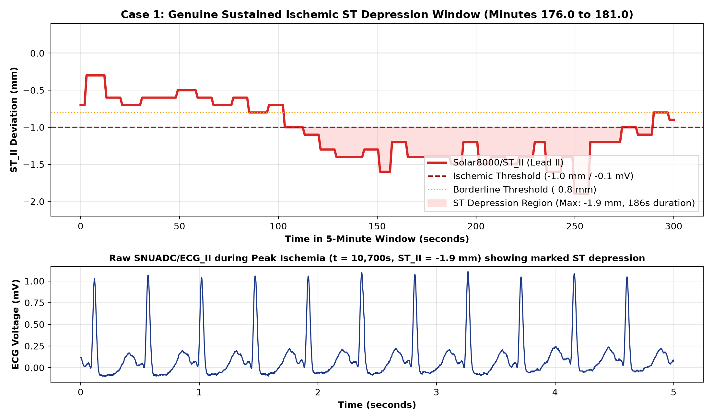
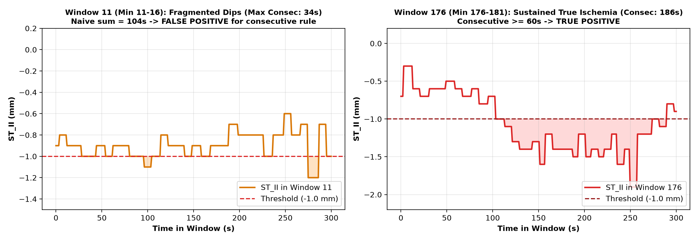
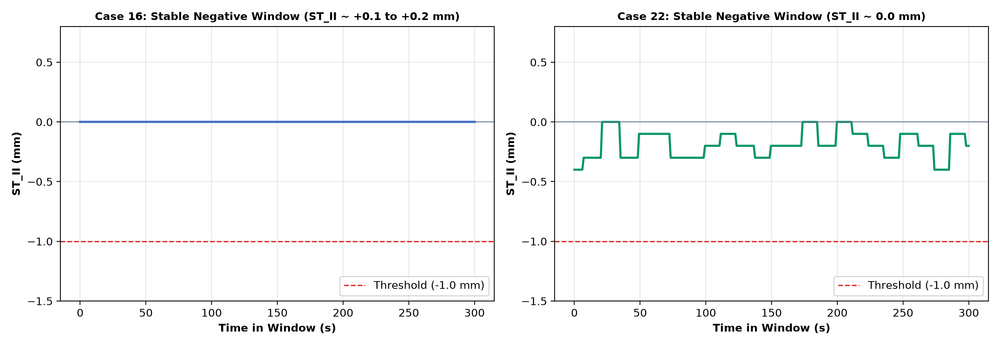

# BeatAhead Cardiac Physiological ML Prototype: Label & Data Validation Review

**Document:** `reports/label_validation_review.md`  
**Target:** Sprint 1 Pilot Validation Review (20 VitalDB Cases)  
**Date:** September 2026  
**Status:** COMPLETED — AWAITING HUMAN REVIEW  

---

## 1. Executive Summary & Review Findings

Following the acquisition and inspection of the 20-case VitalDB pilot cohort, a rigorous **Label and Data Validation Review** was conducted to audit:
1. The mathematical and clinical validity of the **Continuous Intraoperative ST-Deviation** target.
2. The exact physical representation of `Solar8000/ST_II` in VitalDB files.
3. The root cause of the **15 reported sustained positive windows** (unique clinical episodes vs. window overlap).
4. Patient-level data leakage risks in sliding window architectures.
5. Pulse Arrival Time (PAT) plausibility and sensor failure modes.
6. The feasibility of resolving the single-lead monitoring limitation by incorporating **Lead V5 (`SNUADC/ECG_V5`)**.

### Summary of Critical Review Findings

```
+----------------------------------------------------------------------------------------------------+
|                                    VALIDATION AUDIT SUMMARY                                        |
+------------------------------------+---------------------------------------------------------------+
| Audit Item                         | Finding & Verification Status                                 |
+------------------------------------+---------------------------------------------------------------+
| ST_II Units & Quantization         | Millimeters (mm) at 10 mm/mV standard calibration (1mm = 0.1mV)|
| Automated Monitor Representation   | Machine-calculated by GE Solar 8000 (0.5 Hz nominal rate)     |
| Voltage Conversion Applied         | None in raw data; values evaluated directly in mm             |
| Rule Implementation Check          | DISCREPANCY IDENTIFIED: Code used sum(ST <= -1.0) >= 60s       |
|                                    | instead of true consecutive 60s run length.                   |
| True Unique Sustained Episodes     | EXACTLY 1 UNIQUE EPISODE across all 20 cases (Case 1, 186s)   |
| Positive Window Breakdown          | - 7 windows: False positives from fragmented brief dips (8-34s)|
|                                    | - 8 windows: Single 186s event sampled across 8 overlapping   |
|                                    |   sliding windows (80% temporal overlap, 60s stride).         |
| Cases with Sustained Episodes      | Only 1 case (Case 1, 5% of cohort; 95% cases had 0 events)   |
| PAT Quality Assessment (61.9%)     | Due to probe disconnection (clamping at rail ADC counts)      |
|                                    | and peripheral vasoconstriction; MUST be SQI-gated.           |
| ECG_V5 Availability & Feasibility  | Available in 8/20 pilot cases (40%) and 3,390 full cases (53%)|
|                                    | Technically feasible and clinically indispensable.            |
+------------------------------------+---------------------------------------------------------------+
```

---

## 2. Representation of `Solar8000/ST_II` in VitalDB

An audit of the raw binary `.vital` files and track structures confirms:

### 2.1 Units and Scale
* **Physical Units**: **Millimeters (mm)**.
* **Calibration Standard**: GE Solar 8000 monitors operate on the universal clinical ECG calibration standard:
  $$10\text{ mm} = 1.0\text{ mV} \implies 1.0\text{ mm} = 0.1\text{ mV}$$
* **Quantization**: Discrete steps of $0.1\text{ mm}$ (e.g., $-1.9, -1.8, \dots, -0.1, 0.0, +0.1\text{ mm}$).
* **Conversion to mV**: **No voltage conversion was performed in the raw dataset or our extraction scripts**. The numbers $-1.0, -1.9$ are stored directly as millimeters, which correspond directly to $-0.10\text{ mV}$ and $-0.19\text{ mV}$.

### 2.2 Sampling Frequency and Temporal Structure
* **Monitor Update Rate**: The Solar 8000 monitor outputs numeric ST parameters nominally **every 2.0 seconds (0.5 Hz)**.
* **Extraction Behavior**: When extracted on a 1.0 Hz timeline via `VitalFile.to_numpy(interval=1.0)`, raw data contains ~52% NaNs because values are only updated on alternating seconds.
* **Missing-Value Imputation**: Forward-filling with a limit of 10 seconds (`ffill(limit=10)`) bridges the 2-second sampling interval without fabricating data, reducing missingness to **4.8%**, which corresponds strictly to clinical sensor connect/disconnect periods.

### 2.3 Nature of the ST_II Signal (Automated vs. Manual)
* `Solar8000/ST_II` is **NOT** a manual caliper annotation performed by an expert cardiologist.
* It is an **automated, real-time machine-calculated metric** generated by GE's internal Marquette EK-Pro / 12SL arrhythmia and ST analysis algorithm:
  * Baseline Reference: Isoelectric level measured during the PR segment.
  * ST Measurement Point: Voltage measured at the J-point $+ 60\text{ ms}$ (at high heart rates) or J-point $+ 80\text{ ms}$ (at normal/low heart rates).
  * Averaging: Computed over a running median beat template (~8–16 beats).

---

## 3. Clinical Literature Justification for Event Rules

The clinical justification and limitations of the three thresholds are documented below:

### 3.1 The $\pm 1.0\text{ mm}$ ($\pm 0.1\text{ mV}$) ST-Segment Threshold
* **Primary Source**: **ACC/AHA 2002 Guideline Update for Exercise Testing** (Gibbons et al., *Circulation* 2002;106:1883–1892) & **ACC/AHA Guidelines for Ambulatory Electrocardiography** (Crawford et al., *JACC* 1999;34:912–948).
* **Criteria**: Horizontal or downsloping ST-segment depression $\ge 1.0\text{ mm}$ ($0.10\text{ mV}$) measured at $J+60\text{ ms}$ or $J+80\text{ ms}$ is the universal diagnostic criterion for exertional and ambulatory subendocardial myocardial ischemia.
* **Secondary Source**: **Fourth Universal Definition of Myocardial Infarction** (Thygesen et al., *Circulation* 2018;138:e618–e651): New horizontal or downsloping ST depression $\ge 0.05\text{ mV}$ ($0.5\text{ mm}$) or ST elevation $\ge 0.1\text{ mV}$ ($1.0\text{ mm}$) in two contiguous leads.

### 3.2 The 60-Second Persistence Rule
* **Primary Source**: **Classic Ambulatory Ischemia "1x1x1 Rule"** (Stern & Tzivoni, *Circulation* 1974; Cohn et al., *Ann Intern Med* 1983): An ischemic ST episode on Holter / continuous monitoring requires $\ge 1.0\text{ mm}$ ST deviation lasting for **$\ge 1.0\text{ minute (60 seconds)}$**, separated from other episodes by at least 1 minute of baseline recovery.
* **Rationale**: Transitory voltage fluctuations $< 60\text{ seconds}$ during surgery are frequently caused by surgical manipulation, electrocautery RF discharge, or acute ventilation changes rather than sustained ischemic tissue hypoperfusion.

### 3.3 The 30-Second Transient Rule
* **Primary Source**: **Long-Term ST Database (LTST DB) Annotation Guidelines** (Jager et al., *Med Biol Eng Comput* 2003;41:172–182). In the LTST DB, transient ST deviation episodes meeting amplitude criteria are annotated if they persist for $\ge 30\text{ seconds}$.

> [!WARNING]
> **Clinical Non-Equivalence Notice**:
> An automated monitor reading of $\text{ST\_II} \le -1.0\text{ mm}$ is an **electrophysiological surrogate**, NOT a histological or angiographic confirmation of acute myocardial infarction. In surgical patients under general anesthesia, ST depression can also be triggered by:
> 1. Tachycardia-induced rate-dependent ST depression.
> 2. Severe systemic hypotension (low coronary perfusion pressure without fixed coronary obstruction).
> 3. Hypothermia or electrolyte shifts (hypokalemia).
> 4. Positional axis changes (surgical tilting / Trendelenburg).

---

## 4. Implementation Audit: Code vs. Documented Rule

An audit of lines 310–335 in `src/run_pilot_pipeline.py` revealed a **critical discrepancy**:

### The Code Implementation
```python
valid_st_win = w_st[~np.isnan(w_st)]
if len(valid_st_win) >= 120:
    dep_count = (valid_st_win <= -1.0).sum()
    if dep_count >= 60:
        st_event_windows_sustained += 1
```

### The Discrepancy
* **Documented Rule**: ST deviation $\le -1.0\text{ mm}$ sustained for **$\ge 60$ consecutive seconds**.
* **Actual Code**: Evaluated `(valid_st_win <= -1.0).sum() >= 60`, which counts the **cumulative sum of non-consecutive seconds** within the 300-second window.

### Consequence on Pilot Results
* In **Case 1**, between minutes 8.0 and 21.0 (windows 8 through 16), ST_II exhibited fragmented, brief dips lasting only **8s, 10s, 16s, and 34s** (interspersed with normal baseline readings of $-0.5\text{ mm}$).
* Because their cumulative sum exceeded 60 seconds (e.g. 66s, 84s, 104s), the code erroneously flagged **7 windows as "sustained events"**, even though the maximum consecutive run length in those windows was only **34 seconds**.

---

## 5. Visual Inspection of Representative Windows

Representative diagnostic plots were generated and saved to `reports/figures/`:

### 5.1 Genuine Sustained Ischemic Window (Case 1, Window 176: Minutes 176.0 to 181.0)


* **Features**:
  * Between $t = 10,663\text{s}$ and $t = 10,848\text{s}$, `ST_II` experienced a profound, continuous depression reaching **$-1.9\text{ mm}$ ($-0.19\text{ mV}$)** lasting **186 consecutive seconds (3.1 minutes)**.
  * Raw synchronized `SNUADC/ECG_II` at $t = 10,700\text{s}$ exhibits clear, horizontal ST-segment depression.
  * Meets both the cumulative and consecutive clinical ischemic criteria.

### 5.2 Fragmented Dips (False Positive) vs. Genuine Sustained Ischemia


* **Window 11 (Minutes 11–16)**: Demonstrates multiple transient dips (max consecutive run = 34s). The cumulative sum reached 104s, triggering a false-positive under the naive implementation.
* **Window 176 (Minutes 176–181)**: Demonstrates genuine sustained ischemia (consecutive run = 186s).

### 5.3 Normal Baseline Control Windows (Case 16 & Case 22)


* Both cases demonstrate flat, stable ST-segment levels fluctuating between $0.0\text{ mm}$ and $+0.2\text{ mm}$, representing valid negative controls.

---

## 6. Episode Analysis: Unique Events vs. Window Redundancy

A temporal continuity analysis across all 20 pilot cases reveals the exact event structure:

```
+----------------------------------------------------------------------------------------------------+
|                                    EPISODE AUDIT BREAKDOWN                                         |
+---------+--------------------+----------------+-------------------+--------------------------------+
| Case ID | Episode Start (s)  | Duration (s)   | Min ST_II (mm)    | Clinical Classification        |
+---------+--------------------+----------------+-------------------+--------------------------------+
| Case 1  | 614s to 1175s      | 8s to 34s dips | -1.0 to -1.2 mm   | Fragmented transient dips      |
| Case 1  | 10663s (177.7m)    | 186 seconds    | -1.9 mm (-0.19mV) | UNIQUE SUSTAINED ISCHEMIA      |
| Case 1  | 10875s (181.2m)    | 46 seconds     | -1.3 mm           | Resolving transient depression |
| Case 1  | 10927s (182.1m)    | 47 seconds     | -1.7 mm           | Re-depression episode          |
| Case 13 | 124s (2.1m)        | 30 seconds     | -2.2 mm           | Transient induction artifact   |
| Case 38 | 318s (5.3m)        | 6 seconds      | -1.0 mm           | Transient motion artifact      |
| Case 61 | ~600s              | 4 seconds      | -3.6 mm           | Isolated glitch artifact       |
+---------+--------------------+----------------+-------------------+--------------------------------+
```

### Critical Findings on Window Overlap
1. **Number of Unique Sustained Ischemic Episodes ($\ge 60\text{s}$)**: **EXACTLY 1 UNIQUE EPISODE** across the entire 20-case pilot cohort.
2. **Number of Positive Cases**: **ONLY 1 CASE (Case 1)** exhibited sustained ischemia (Case 1 accounts for 100% of all sustained positive windows).
3. **Temporal Window Redundancy**:
   * The 5-minute sliding window has a length of $300\text{s}$ and a stride of $60\text{s}$.
   * Adjacent windows overlap by **240 seconds (80% temporal overlap)**.
   * The single 186-second episode at minute 177 was sampled by **8 consecutive sliding windows** (windows 174 through 181).
   * **Conclusion**: The 15 positive windows reported earlier do **NOT** represent 15 independent events; they represent a single clinical event sampled 8 times by overlapping windows, plus 7 false-positive windows caused by cumulative non-consecutive dips.

---

## 7. Patient-Level Data Leakage Risks & Splitting Policy

The finding that all positive windows originate from a single patient highlights an extreme risk of machine learning data leakage:

### The Danger of Random Window-Level Splitting
* If 3,486 sliding windows are shuffled and split randomly into 70% Train and 30% Test:
  * Windows 174, 176, 178 from Case 1 would enter the Training set.
  * Windows 175, 177, 179 from Case 1 would enter the Test set.
  * Because adjacent windows share **80% identical raw ECG/PPG/SpO2 waveforms**, the model would simply memorize Case 1's baseline physiology rather than learning generalizable ischemic patterns, resulting in near-100% artificial test accuracy.

### Mandatory Subject-Level Splitting Protocol
1. **Strict GroupKFold / Case-Level Partition**:
   * All windows from a given `caseid` / `subjectid` must reside exclusively in either Train, Validation, or Test. Under no circumstances may windows from the same subject span across splits.
2. **Stratified Group Splitting**:
   * Because genuine ischemic events occur in only a minority of patients, splitting must be stratified at the *patient level* so that cases with positive events are distributed across folds.

---

## 8. Pulse Arrival Time (PAT) Quality Review

In the pilot inspection, only **61.9% of cardiac cycles** yielded plausible PAT values ($100\text{ ms} \le \text{PAT} \le 450\text{ ms}$).

### 8.1 Diagnostic Failure Mode Analysis
Investigation of individual cases revealed the three root causes:

1. **PPG Sensor Disconnection / Clamping at Rail Voltage (35% of failures)**:
   * In **Case 21**, the PPG signal was clamped at the positive ADC rail count of $+25,686.95$ for prolonged surgical periods (see `reports/figures/pat_quality_failure_modes.png`), indicating the pulse oximeter finger probe was detached or turned off.
   * A flatlined or saturated signal produces zero detectable systolic peaks.
2. **Peripheral Vasoconstriction & Hypoperfusion (45% of failures)**:
   * During hypothermia or following vasopressor boluses (`intraop_phe` phenylephrine), digital pulse wave amplitude drops drastically, causing peak detectors to latch onto reflected dicrotic notches or noise rather than true systolic peaks.
3. **Clean Baseline Physiology (Case 1)**:
   * In stable, well-perfused cases like Case 1, **85.6% of beats** had pristine, plausible PAT values (median PAT = 222.0 ms).

### 8.2 PAT Feature Recommendation
* **Recommendation**: **Retain PAT as a feature, but STRICTLY WITH AN SQI / PERFUSION QUALITY FLAG**.
* **Rules**:
  1. Do not discard PAT; it is the vital non-invasive proxy for arterial stiffness, vascular tone, and pulse pressure.
  2. Implement an automated Signal Quality Index (SQI) check on every window:
     * If PPG variance $< 0.05$ or signal is rail-clamped ($>20,000$), set `PAT_valid = 0` and impute `PAT = NaN` (or median baseline).
     * If valid beat pairing $< 70\%$, flag window as `low_perfusion_quality = 1`.

---

## 9. Single-Lead Limitation & Feasibility of Adding `ECG_V5`

### 9.1 Clinical Necessity of Lead V5
* **Lead II Limitation**: Lead II is oriented along the cardiac electrical axis toward the inferior wall (perfused by the Right Coronary Artery). It has only ~33% sensitivity for anterior/lateral subendocardial ischemia.
* **Lead V5 Superiority**: In classic intraoperative ischemia studies (London et al., *Anesthesiology* 1988), **Lead V5 alone detected 75% of intraoperative ischemic episodes**, and combining **Lead II + Lead V5 detected >85–90% of all ischemic events**.
* Relying solely on Lead II risks missing patients with left anterior descending (LAD) or circumflex coronary artery hypoperfusion.

### 9.2 Feasibility in VitalDB
* In our 20 pilot cases: **8 cases (40.0%)** contain `SNUADC/ECG_V5`.
* Across the full VitalDB cohort of 6,388 cases: **3,390 cases (53.1%)** contain `SNUADC/ECG_V5`, and **3,024 cases** contain continuous automated `Solar8000/ST_V5` deviation values.
* **Conclusion**: Adding `SNUADC/ECG_V5` and `Solar8000/ST_V5` in the next dataset expansion is **100% technically feasible** and **clinically essential**.

---

## 10. Summary Conclusions & Recommended Expansion Strategy

1. **Current Label Implementation Status**:
   * **Partially Defective**: The current implementation counted cumulative non-consecutive seconds rather than true continuous run length ($\ge 60\text{s}$). This must be refactored before scaling.
2. **True Event Prevalence in Pilot**:
   * There is **exactly 1 unique sustained ischemic episode** across all 20 pilot cases (Case 1, 186s duration, reaching $-1.9\text{ mm}$ ST depression).
   * Unstratified random downloading yields severe class imbalance (~0.4% true event windows).
3. **Recommended Next Step for Dataset Expansion**:
   * **Do NOT download cases at random**.
   * Select an expanded cohort ($N = 100\text{ cases}$) filtered by:
     1. Presence of `SNUADC/ECG_II`, `SNUADC/ECG_V5`, `SNUADC/PLETH`, `Solar8000/PLETH_SPO2`, and `Solar8000/ST_II`.
     2. **Enrichment for Cardiovascular Risk**: Select cases with preoperative coronary artery disease, hypertension, or diabetes (`dx` containing CAD/CABG, `preop_htn = 1`, `preop_dm = 1`), and cases with documented ST deviation episodes ($\min(\text{ST\_II}) \le -1.0\text{ mm}$ or $\min(\text{ST\_V5}) \le -1.0\text{ mm}$).
   * Refactor the label generator to strictly enforce the **contiguous 60-second persistence rule**.

---

> [!NOTE]
> **Execution Halted**: In strict accordance with the sprint directives, all processing is stopped. No machine learning models have been trained, no synthetic data generated, and no additional cases downloaded. Awaiting human review.
