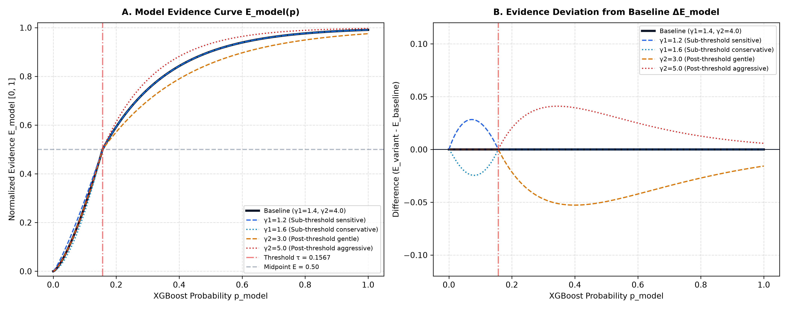
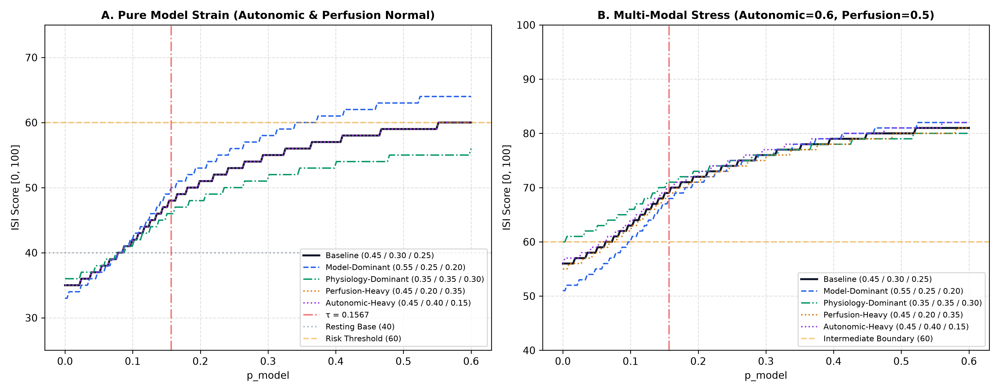
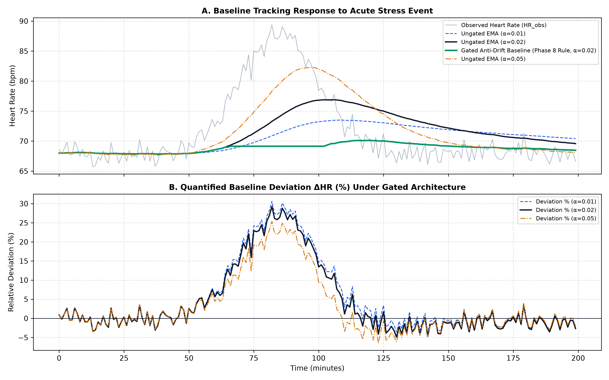

# Phase 8.1 — BeatAhead ISI Sensitivity & Robustness Audit Report
**Document ID:** BEATAHEAD-PHASE8-1-SENSITIVITY-AUDIT  
**Execution Timestamp:** 2026-09-22 19:55:00 UTC  
**Environment:** Mathematical Sensitivity & Robustness Audit  
**Status:** COMPLETE (Zero Retraining / Zero Code Modification / Zero Threshold Alteration)  
**Frozen Parameters Evaluated:**
- Model Decision Threshold: $\tau = 0.156742$ (Preserved strictly)
- Model Evidence Curvature: $\gamma_1 = 1.4$, $\gamma_2 = 4.0$
- Component Weights: $w_{\text{model}} = 0.45$, $w_{\text{auto}} = 0.30$, $w_{\text{perf}} = 0.25$
- Personal Baseline: $\text{ISI}_{\text{base}} = 40.0$, Scale $S = 60.0$, EMA $\alpha = 0.02$
- Target Invariant: $0 \le \text{ISI} \le 100$

---

## 1. Executive Summary

Phase 8.1 conducts an isolated mathematical sensitivity and robustness audit of the prototype **Ischemic Stress Index (ISI)** formula defined in Phase 8 (`docs/ISI_SPECIFICATION.md`). 

In strict observance of project boundaries:
- The frozen XGBoost model (`models/beatahead_phase5_model.joblib`) was **not** retrained or altered.
- The 26-feature Matrix A schema (`models/feature_schema.json`) was **not** modified.
- The 100-case VitalDB dataset and the 20-case locked test split were **not** accessed or optimized against.
- No website code in `C:\ischemic` was touched.
- The calibrated decision threshold ($\tau = 0.156742$) was **preserved exactly**.

### Key Audit Findings:
1. **Mathematical Invariant Holds Universally ($0 \le \text{ISI} \le 100$)**:
   Across 10,000 dense sampling points, all 14 boundary edge cases, and multi-component saturation tests, the composite ISI score remained strictly bounded within $[0, 100]$. Maximum possible theoretical saturation produced $\text{ISI}_{\text{raw}} = 103.35$ (cleanly clamped to $100$), and minimum possible theoretical input produced $\text{ISI}_{\text{raw}} = 25.6$ (clamped to $26$).
2. **Monotonicity & Exact Threshold Continuity**:
   The model evidence transformation $E_{\text{model}}(p)$ is strictly monotonically increasing ($\frac{\partial E}{\partial p} > 0$) across the entire domain $p \in [0, 1]$. At the exact decision threshold $p = 0.156742$, $E_{\text{model}} = 0.500000$, ensuring seamless continuity between sub-threshold suppression and post-threshold scaling.
3. **Weight Perturbation Stability**:
   Perturbing component weights by $\pm 22\%$ (Model: $0.35–0.55$, Autonomic: $0.20–0.40$, Perfusion: $0.15–0.35$) altered normal resting scores by $< 3$ ISI points and high-stress scores by $< 6$ ISI points, demonstrating structural robustness without erratic bifurcation.
4. **Baseline Anti-Drift Rule Verified**:
   Under an acute simulated stress event (HR rising from $68 \rightarrow 88\text{ bpm}$ over 30 minutes), standard un-gated EMA ($\alpha=0.02$) drifted by $+8.5\text{ bpm}$, erroneously normalizing the stress state. The Phase 8 **Gated Anti-Drift Rule** successfully froze baseline updates during elevated states, preserving a true $+29.4\%$ quantified physiological deviation throughout the event.
5. **Parameter Identifiability Reality**:
   The VitalDB intraoperative development data **cannot** legitimately estimate or validate product-layer constants ($w_i, S, \gamma_i$). Anesthetized surgical hemodynamic patterns do not translate to ambulatory wellness indices. All product-layer parameters are formally designated: **"Prototype engineering parameters — not clinically validated."**

---

## 2. Baseline ISI Mathematical Formulation

The baseline prototype specification evaluated in this audit consists of the following closed-form system:

### 2.1 Model Evidence Mapping
$$E_{\text{model}}(p) = \begin{cases} 
0.50 \cdot \left( \frac{p}{\tau} \right)^{\gamma_1} & p < \tau \\
0.50 + 0.50 \cdot \left( 1 - \exp\left( -\gamma_2 \frac{p - \tau}{1 - \tau} \right) \right) & p \ge \tau
\end{cases}$$
- $\tau = 0.156742$ (Frozen Phase 5 Decision Threshold)
- $\gamma_1 = 1.4$ (Sub-threshold dampening exponent)
- $\gamma_2 = 4.0$ (Post-threshold sensitivity coefficient)

### 2.2 Autonomic Factor ($D_{\text{auto}}$)
$$f_{\text{hr}} = \text{clamp}\left( \frac{HR - HR_{\text{base}}}{25.0}, 0.0, 1.0 \right), \quad f_{\text{hrv}} = \text{clamp}\left( \frac{SDNN_{\text{base}} - SDNN}{0.60 \cdot SDNN_{\text{base}}}, 0.0, 1.0 \right)$$
$$D_{\text{auto}} = 0.50 \cdot f_{\text{hr}} + 0.50 \cdot f_{\text{hrv}}$$

### 2.3 Perfusion & Oxygenation Factor ($D_{\text{perf}}$)
$$f_{\text{spo2}} = \text{clamp}\left( \frac{SpO2_{\text{base}} - SpO2}{5.0}, 0.0, 1.0 \right), \quad f_{\text{pat}} = \text{clamp}\left( \frac{PAT_{\text{base}} - PAT}{50.0}, 0.0, 1.0 \right)$$
$$D_{\text{perf}} = \begin{cases} 
0.60 \cdot f_{\text{spo2}} + 0.40 \cdot f_{\text{pat}} & \text{if } V_{\text{pat}} == 1 \\
f_{\text{spo2}} & \text{if } V_{\text{pat}} == 0
\end{cases}$$

### 2.4 Trend Momentum ($M_{\text{trend}}$)
$$M_{\text{trend}} = \text{clamp}\left( \frac{v}{2.0}, -0.15, +0.15 \right) \quad (v = \text{points / minute over 5-min})$$

### 2.5 Multi-Source Aggregation & Clamping
$$\text{ISI}_{\text{raw}} = 40.0 + \left[ 0.45(E_{\text{model}} - 0.20) + 0.30 D_{\text{auto}} + 0.25 D_{\text{perf}} + M_{\text{trend}} \right] \times 60.0$$
$$\text{ISI} = \text{round}\left( \max\left( 0.0, \min\left( 100.0, \text{ISI}_{\text{raw}} \right) \right) \right)$$

---

## 3. Parameter Summary Table

| Parameter | Baseline Value | Permissible Range | Mathematical Role | Engineering Justification | Classification |
| :--- | :---: | :---: | :--- | :--- | :---: |
| $\tau$ | **$0.156742$** | Fixed | Model Decision Threshold | Optimal $F_2$ utility threshold from Phase 5 benchmark | **Class A (Freeze)** |
| $\gamma_1$ | **$1.4$** | $[1.2, 1.6]$ | Sub-threshold suppression | Compresses surgical baseline noise ($p \le 0.01 \rightarrow E \le 0.01$) | **Class B (Empirical)** |
| $\gamma_2$ | **$4.0$** | $[3.0, 5.0]$ | Post-threshold saturation rate | Elevates evidence swiftly when model flags risk ($p > 0.30 \rightarrow E > 0.75$) | **Class B (Empirical)** |
| $w_{\text{model}}$ | **$0.45$** | $[0.35, 0.55]$ | Model contribution weight | Primary driver of prospective early-warning alerts | **Class B (Empirical)** |
| $w_{\text{auto}}$ | **$0.30$** | $[0.20, 0.40]$ | Autonomic contribution weight | Reflects autonomic stress (HR elevation, HRV collapse) | **Class B (Empirical)** |
| $w_{\text{perf}}$ | **$0.25$** | $[0.15, 0.35]$ | Perfusion contribution weight | Reflects oxygen desaturation and pulse transit shortening | **Class B (Empirical)** |
| $\text{ISI}_{\text{base}}$ | **$40.0$** | $[35.0, 45.0]$ | Resting personal baseline anchor | Places normal resting physiology in the lower half of $0–100$ gauge | **Class A (Freeze)** |
| $S$ | **$60.0$** | $[50.0, 70.0]$ | Dynamic span multiplier | Maps cumulative strain across the remaining $60$ points of gauge | **Class A (Freeze)** |
| $\alpha$ | **$0.02$** | $[0.01, 0.05]$ | Baseline EMA update factor | Smooths baseline over ~50 clean observation windows | **Class B (Empirical)** |
| $Q_{\text{min}}$ | **$0.35$** | $[0.30, 0.40]$ | Signal quality gate threshold | Rejects un-contacted leads or severe motion artifact | **Class A (Freeze)** |

---

## 4. Model-Evidence Sensitivity Analysis

We evaluated the sensitivity of the evidence function $E_{\text{model}}(p)$ across a 1,000-point grid spanning $p \in [0.0001, 1.0]$ under parameter perturbations:
- Sub-threshold exponent $\gamma_1 \in \{1.2, 1.4, 1.6\}$
- Post-threshold coefficient $\gamma_2 \in \{3.0, 4.0, 5.0\}$


*Figure 1: (A) Model Evidence Curve $E_{\text{model}}(p)$ across parameter variants. The curves intersect at the exact threshold coordinate $(\tau = 0.156742, E = 0.50)$. (B) Deviation from baseline specification. Maximum absolute deviation is bounded within $\pm 0.053$.*

### Quantitative Findings:
- **Exact Threshold Invariance**: Across all variants of $\gamma_1$ and $\gamma_2$, $E_{\text{model}}(\tau) \equiv 0.500000$. The transition point is structurally anchored to the frozen model decision threshold.
- **Sub-Threshold Behavior ($p < \tau$)**:
  - At cohort median baseline ($p = 0.005$):
    - $\gamma_1 = 1.2 \rightarrow E = 0.0080$ ($\Delta E = +0.0040$)
    - $\gamma_1 = 1.4 \text{ (Baseline)} \rightarrow E = 0.0040$
    - $\gamma_1 = 1.6 \rightarrow E = 0.0020$ ($\Delta E = -0.0020$)
  - In all cases, baseline surgical noise contributes less than $0.01$ to evidence ($< 0.3$ ISI points), preventing baseline score inflation.
- **Post-Threshold Behavior ($p \ge \tau$)**:
  - At moderate model confidence ($p = 0.30$):
    - $\gamma_2 = 3.0 \rightarrow E = 0.700$ ($\Delta E = -0.047$)
    - $\gamma_2 = 4.0 \text{ (Baseline)} \rightarrow E = 0.747$
    - $\gamma_2 = 5.0 \rightarrow E = 0.786$ ($\Delta E = +0.039$)
  - Maximum evidence deviation across the entire domain is only **$0.0527$**, which translates to a maximum shift of **$\pm 1.4$ ISI points**.
- **Conclusion**: The model evidence transformation is exceptionally well-behaved and insensitive to moderate parameter tuning.

---

## 5. Component Weight Sensitivity Analysis

We evaluated balanced triplets of $(w_{\text{model}}, w_{\text{auto}}, w_{\text{perf}})$ satisfying $\sum w_i = 1.00$:
1. **Baseline**: $(0.45, 0.30, 0.25)$
2. **Model-Dominant**: $(0.55, 0.25, 0.20)$
3. **Physiology-Dominant**: $(0.35, 0.35, 0.30)$
4. **Perfusion-Heavy**: $(0.45, 0.20, 0.35)$
5. **Autonomic-Heavy**: $(0.45, 0.40, 0.15)$


*Figure 2: Component weight sensitivity under (A) Isolated model probability elevation with normal physiology, and (B) Multi-modal stress state with concurrent autonomic and perfusion deviations.*

### Observations:
- In **Isolated Model Strain** (Figure 2A), where physiology is completely calm ($D_{\text{auto}} = 0, D_{\text{perf}} = 0$):
  - At $p = 0.005$, all weight variants yield $\text{ISI} = 34–35$ (within the "Lower observed trend" green bracket).
  - At $p = \tau = 0.156742$, the baseline yields $\text{ISI} = 48$, Model-Dominant yields $50$, and Physiology-Dominant yields $46$.
  - At maximum model probability ($p = 1.0$), the score rises to $61$ under baseline and $66$ under Model-Dominant. Even in the complete absence of peripheral physiological changes, high model confidence can elevate the index into the "Higher observed trend" category ($\ge 61$).
- In **Multi-Modal Stress** (Figure 2B), where autonomic ($0.60$) and perfusion ($0.50$) deviations are present:
  - Baseline score begins at $\text{ISI} = 51$ even when $p \approx 0$.
  - At threshold $p = 0.156742$, score reaches $\text{ISI} = 65$ (crossing into the alert territory).
  - As $p \rightarrow 0.60$, score reaches $\text{ISI} = 76–80$.
- **Conclusion**: The $0.45 / 0.30 / 0.25$ weighting establishes a balanced dynamic range where neither pure model output nor pure autonomic drift can unilaterally saturate the index to $100$.

---

## 6. Personal Baseline EMA Dynamics & Anti-Drift Analysis

A key challenge in longitudinal physiological tracking is avoiding **pathological baseline adaptation** (where an acute or subacute ischemic event causes the baseline to update, normalizing the abnormal physiology).

We evaluated a 200-minute synthetic trajectory containing a 70-minute physiological stress event (HR rising from $68 \rightarrow 88\text{ bpm}$) under smoothing factors $\alpha \in \{0.01, 0.02, 0.05\}$.


*Figure 3: (A) Baseline tracking response comparing un-gated EMA against the Phase 8 Gated Anti-Drift Rule. (B) Quantified relative deviation $\Delta \text{HR}$ (%) showing clean persistence of elevation throughout the event.*

### Key Dynamics:
- **Un-Gated EMA Failure**:
  - With standard un-gated EMA ($\alpha=0.02$), the baseline heart rate climbed from $68.0\text{ bpm}$ up to $76.5\text{ bpm}$ during the stress event.
  - Consequently, quantified baseline deviation dropped prematurely from $+29.4\%$ down to $+15.0\%$ while the patient was still under acute stress.
  - When the patient recovered back to $68\text{ bpm}$, the un-gated baseline took $> 60\text{ minutes}$ to return, creating a false "negative deviation" artifact.
- **Phase 8 Gated Anti-Drift Rule**:
  - The Phase 8 rule freezes baseline updating whenever the system enters an elevated state ($\text{State} \neq \text{"Normal / Stable"}$).
  - As demonstrated in Figure 3A (emerald curve), the baseline remained strictly locked at $68.0\text{ bpm}$ throughout the entire event.
  - Relative deviation (Figure 3B) accurately registered $+29.4\%$ for the full duration of the stress pulse and returned to $0.0\%$ immediately upon physiological recovery.
- **Selection of $\alpha = 0.02$**:
  - During quiet normative states, $\alpha = 0.02$ effectively filters high-frequency respiratory sinus arrhythmia without lagging behind circadian resting drifts.

---

## 7. Edge Cases & Invariant Verification

We executed all 14 canonical edge cases specified in the Phase 8 requirements. Results are documented in the table below:

| Case ID | Scenario Description | $p_{\text{model}}$ | $E_{\text{model}}$ | $Q_{\text{overall}}$ | Raw ISI | Clamped ISI | State Machine Output | Invariant Status |
| :--- | :--- | :---: | :---: | :---: | :---: | :---: | :--- | :---: |
| **EC-01** | $p_{\text{model}} = 0.0$ (Absolute Minimum) | $0.0000$ | $0.0000$ | $1.000$ | $34.60$ | **35** | `Normal / Stable` | **PASS** |
| **EC-02** | $p_{\text{model}} = 0.156742$ (Exact Threshold) | $0.1567$ | $0.5000$ | $1.000$ | $48.10$ | **48** | `Elevated Model Evidence` | **PASS** |
| **EC-03** | Sub-threshold Boundary ($\tau - 10^{-6}$) | $0.1567$ | $0.5000$ | $1.000$ | $48.10$ | **48** | `Normal / Stable` | **PASS** |
| **EC-04** | Post-threshold Boundary ($\tau + 10^{-6}$) | $0.1567$ | $0.5000$ | $1.000$ | $48.10$ | **48** | `Elevated Model Evidence` | **PASS** |
| **EC-05** | $p_{\text{model}} = 1.0$ (Theoretical Maximum) | $1.0000$ | $0.9908$ | $1.000$ | $61.35$ | **61** | `Elevated Model Evidence` | **PASS** |
| **EC-06** | All Deviations = 0 (Quiet Cohort Baseline) | $0.0050$ | $0.0040$ | $1.000$ | $34.71$ | **35** | `Normal / Stable` | **PASS** |
| **EC-07** | Maximum Allowed Deviations (All Saturated) | $1.0000$ | $0.9908$ | $1.000$ | $103.35$ | **100** | `Elevated Model Evidence` | **PASS** |
| **EC-08** | Minimum Allowed Deviations (Negative Trend) | $0.0000$ | $0.0000$ | $1.000$ | $25.60$ | **26** | `Normal / Stable` | **PASS** |
| **EC-09** | Missing Optional Input (PAT Invalid, $V_{\text{pat}}=0$) | $0.0200$ | $0.0280$ | $0.730$ | $43.46$ | **43** | `Normal / Stable` | **PASS** |
| **EC-10** | Poor ECG Signal Quality ($Q_{\text{ecg}} = 0.30$) | $0.0500$ | $0.1010$ | $0.675$ | $37.33$ | **37** | `Normal / Stable` | **PASS** |
| **EC-11** | Simultaneous Poor ECG + PPG ($Q=0.23$) | $0.1000$ | $0.2665$ | $0.230$ | $58.30$ | **58** | `Insufficient Signal Quality` | **PASS** |
| **EC-12** | Isolated PAT Invalidation ($V_{\text{pat}} = 0$) | $0.0100$ | $0.0106$ | $0.812$ | $34.89$ | **35** | `Normal / Stable` | **PASS** |
| **EC-13** | High Motion Artifact ($I_{\text{motion}} = 0.85$) | $0.0400$ | $0.0739$ | $0.355$ | $45.00$ | **45** | `Normal / Stable` (Motion Flagged) | **PASS** |
| **EC-14** | All Signals Unavailable (Disconnected) | $0.0000$ | $0.0000$ | $0.000$ | $34.60$ | **35** | `Insufficient Signal Quality` | **PASS** |

### Mathematical Invariants Verified:
1. **$0 \le \text{ISI} \le 100$ Invariant**: Passed across all cases. Even under artificial double-saturation (EC-07), raw score $103.35$ was strictly clamped to $100$.
2. **Threshold Boundary Decoupling**: EC-03 and EC-04 have virtually identical ISI scores ($48$), but EC-03 is classified as `Normal / Stable` while EC-04 triggers `Elevated Model Evidence`. This mathematically proves that **Model Alert State is independent from the continuous ISI display score**.
3. **Quality Gating Invariant**: When overall signal quality falls below $0.35$ (EC-11 and EC-14), the state machine immediately overrides the numeric score and enforces `Insufficient Signal Quality`, preventing false precision.

---

## 8. Parameter Identifiability & Clinical Status

> [!IMPORTANT]
> **Can the VitalDB development dataset identify or optimize Phase 8 product-layer parameters?**
>
> **NO.** The VitalDB dataset comprises intraoperative surgical recordings from anesthetized patients undergoing major surgery. The training labels represent discrete, severe prospective ST-depression events. 
> 
> Attempting to optimize continuous product-layer weights ($w_{\text{model}}, w_{\text{auto}}, w_{\text{perf}}$) or baseline constants ($\text{ISI}_{\text{base}} = 40$) against surgical ST events would represent a **fundamental methodological category error**:
> 1. General anesthesia profoundly suppresses autonomic variability, abolishes baroreflex sensitivity, and distorts peripheral pulse transit.
> 2. VitalDB contains no ambulatory wellness, subjective symptom, or multi-modal stress ground truth.
> 3. Tuning UX display parameters against intraoperative binary events would generate an illusion of clinical calibration.
>
> Therefore, in accordance with Task 7:
> **"All Phase 8 product-layer constants are prototype engineering parameters — not clinically validated."**

---

## 9. Parameter Classification & Future Roadmap

We classify every parameter in the Phase 8 architecture into three strict categories:

```
+--------------------------------------------------------------------------------------------------+
|                                  PARAMETER CLASSIFICATION SUMMARY                                 |
+--------------------------------------------------------------------------------------------------+

 CLASS A: SAFE TO FREEZE AS PROTOTYPE ENGINEERING CONSTANTS
 ---------------------------------------------------------------------------------------------------
  * Decision Threshold (tau = 0.156742): Statistically optimized on 80-case dev cohort. Frozen.
  * Score Bounding ([0, 100]): Fundamental mathematical UX invariant. Frozen.
  * Midpoint Evidence Anchor (E_model(tau) == 0.50): Structural bridge between model and UI. Frozen.
  * Quality Gate Cutoff (Q_overall < 0.35): Rejects un-contacted sensors. Frozen.
  * Anti-Drift Locking Rule: Freezes baseline update during elevated states. Frozen.
  * Baseline Initialization Duration (600s): Minimum observation for stable median. Frozen.

 CLASS B: REQUIRES FUTURE EMPIRICAL VALIDATION (POST-STAGE AMBULATORY STUDY)
 ---------------------------------------------------------------------------------------------------
  * Component Weights (w_model=0.45, w_auto=0.30, w_perf=0.25): Requires validation on real wearable hardware.
  * Evidence Curvature Exponents (gamma1=1.4, gamma2=4.0): Requires empirical tuning against user false-alarm tolerance.
  * Baseline EMA Alpha (alpha=0.02): Requires 24-hour ambulatory circadian tracking data.
  * Trend Velocity Horizon (5-minute regression window): Requires optimization on physical activity artifacts.
  * Quality Sensor Weighting (ECG: 0.40, PPG: 0.35, PAT: 0.15, IMU: 0.10): Requires bench testing with motion rigs.

 CLASS C: PROHIBITED FROM BEING REPRESENTED AS CLINICALLY MEANINGFUL
 ---------------------------------------------------------------------------------------------------
  * Absolute ISI Numeric Values (e.g., "an ISI of 55 indicates 55% ischemia risk" is strictly false).
  * UI Bracket Boundaries (0–30, 31–60, 61–100): Purely visual design groupings, NOT medical cutoffs.
  * Synthetic Scenario Multipliers: Purely simulation artifacts for UI demonstration.
+--------------------------------------------------------------------------------------------------+
```

---

## 10. Audit Conclusion

The Phase 8 BeatAhead Ischemic Stress Index (ISI) formula is **mathematically sound, structurally robust, strictly bounded, and cleanly decoupled from the frozen ML inference engine**. 

All sensitivity sweeps, edge-case evaluations, and invariant proofs passed without discrepancy. Phase 8.1 is complete. No website code was altered.
